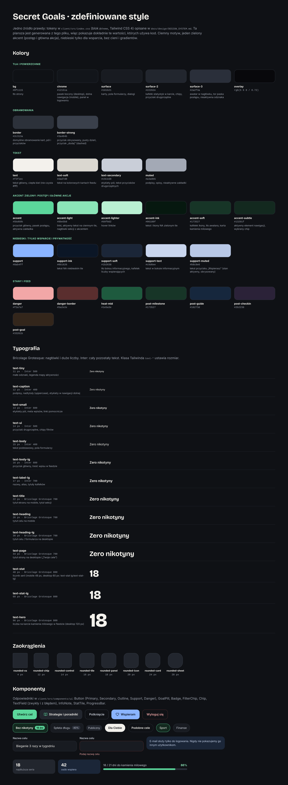
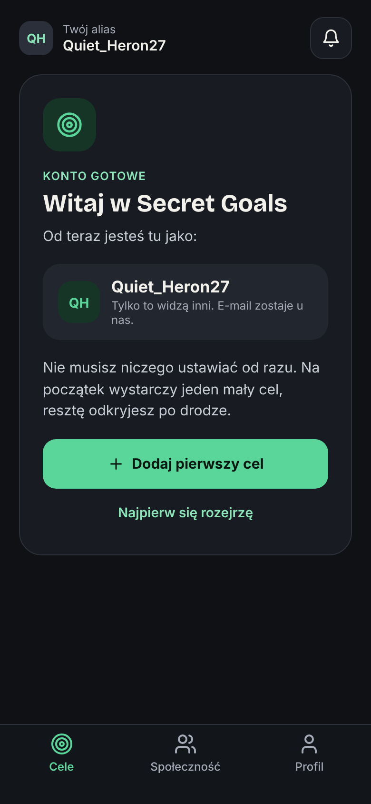
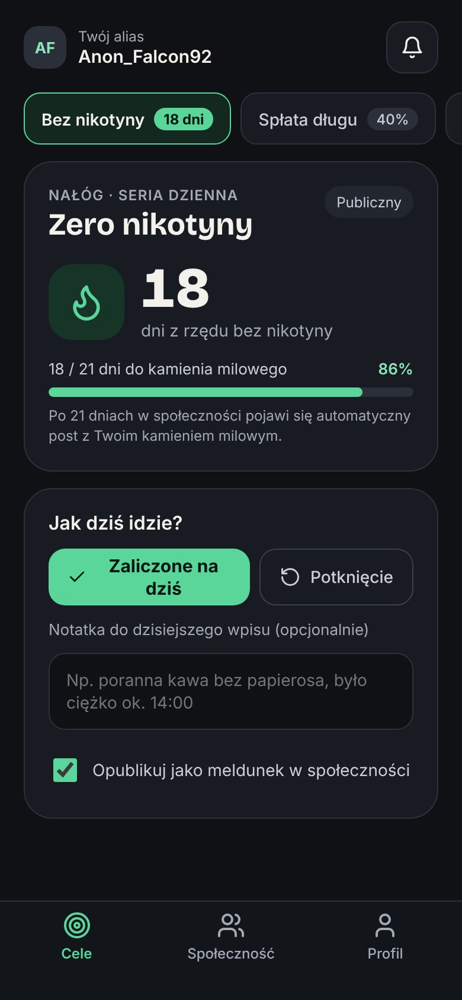
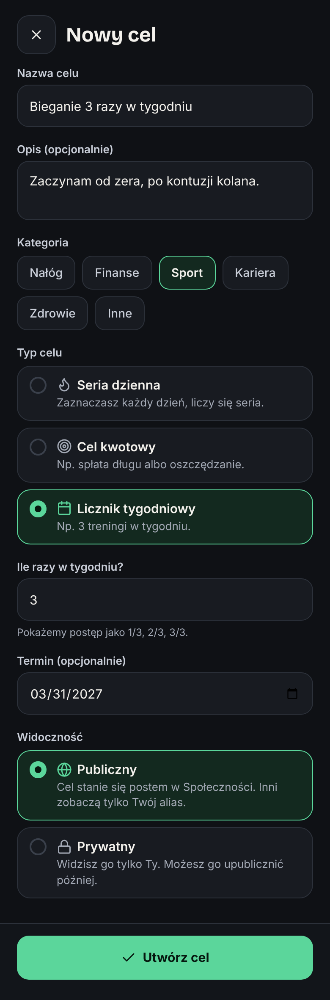
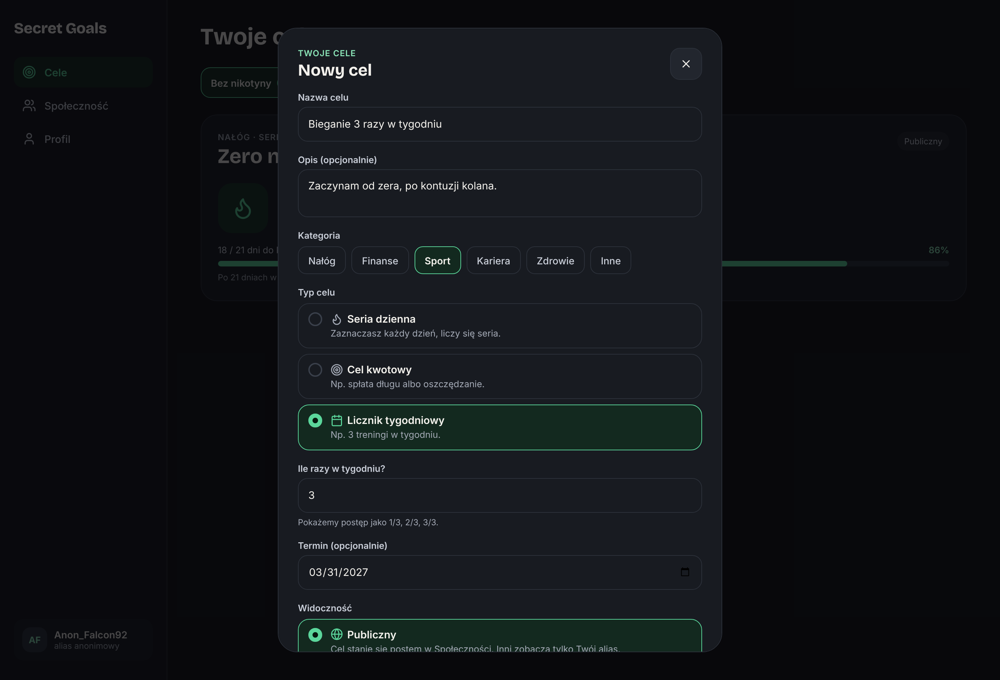

# Makiety high-fidelity Secret Goals

Makiety hi-fi pokazują docelowy wygląd aplikacji na telefonie (390 × 844 px) i na desktopie
(1440 px). Wszystkie ekrany korzystają z jednego, zdefiniowanego zestawu stylów, tego samego, którego
używa kod frontendu. Pliki PNG mają podwójną rozdzielczość (2×).

## Zdefiniowane style

- **Źródło prawdy:** tokeny w [`client/src/index.css`](../../../client/src/index.css) (blok `@theme`,
  Tailwind CSS 4), opis i zasady użycia w [`DESIGN_SYSTEM.md`](../DESIGN_SYSTEM.md).
- **Plansza [`style.png`](style.png)** jest generowana z `index.css`, więc kolory, rozmiary tekstu i
  zaokrąglenia na planszy to dokładnie te wartości, których używa kod: 30 kolorów w 6 grupach,
  14 stopni typografii (Bricolage Grotesque i Inter), 9 zaokrągleń i podstawowe komponenty.
- **Plik Figma:** [Secret Goals – High-Fidelity Mockups](https://www.figma.com/design/eVmMMRZxOHCJpAnI4VnE26).
  Style są tam zapisane jako zmienne Figmy (kolekcja „Secret Goals”: 30 kolorów, 9 zaokrągleń,
  8 odstępów, z nazwami CSS z kodu), 18 stylów tekstu i 16 komponentów z wariantami (Button,
  TextField, GoalPill, Chip, OptionTile, BottomNav, Sidebar i inne). Plik zawiera też pierwsze
  ekrany mobile złożone z tych komponentów.

## Ekrany

| #   | Ekran                                         | User story       | Mobile                                                                                         | Desktop                                         |
| :-- | :-------------------------------------------- | :--------------- | :--------------------------------------------------------------------------------------------- | :---------------------------------------------- |
| 01  | Logowanie                                     | US01             | [PNG](mobile/01-logowanie.png)                                                                 | [PNG](desktop/01-logowanie.png)                 |
| 02  | Rejestracja                                   | US01             | [PNG](mobile/02-rejestracja.png)                                                               | [PNG](desktop/02-rejestracja.png)               |
| 03  | Powitanie po rejestracji (brak celów)         | US01, US02       | [PNG](mobile/03-powitanie.png)                                                                 | [PNG](desktop/03-powitanie.png)                 |
| 04  | Cele: wybrany cel i dzisiejszy postęp         | US02, US03, US05 | [PNG](mobile/04-cele.png)                                                                      | [PNG](desktop/04-cele.png)                      |
| 05  | Nowy cel: formularz                           | US02             | [PNG](mobile/05-nowy-cel.png), [cały formularz](mobile/05b-nowy-cel-calosc.png)                | [PNG](desktop/05-nowy-cel.png)                  |
| 06  | Nowy cel: brak nazwy (walidacja)              | US02             | [PNG](mobile/06-nowy-cel-blad-nazwy.png)                                                       | [PNG](desktop/06-nowy-cel-blad-nazwy.png)       |
| 07  | Nowy cel: błąd serwera lub sieci              | US02             | [PNG](mobile/07-nowy-cel-blad-zapisu.png)                                                      | [PNG](desktop/07-nowy-cel-blad-zapisu.png)      |
| 08  | Cele: postęp zapisany                         | US03             | [PNG](mobile/08-cele-zapisano.png)                                                             | [PNG](desktop/08-cele-zapisano.png)             |
| 09  | Społeczność: komentarze do wpisu              | US04             | [PNG](mobile/09-komentarze.png)                                                                | [PNG](desktop/09-komentarze.png)                |
| 10  | Społeczność: nowy wpis                        | US04             | [PNG](mobile/10-nowy-wpis.png)                                                                 | [PNG](desktop/10-nowy-wpis.png)                 |

Feed Społeczności i własny profil mają gotowe makiety hi-fi z prototypu v2 w
[`docs/prototypes/v2-ui/screenshots`](../../prototypes/v2-ui/screenshots/) (`mobile-community-*.png`,
`desktop-community*.png`, `mobile-profile*.png`, `desktop-profile.png`) i nie powtarzamy ich tutaj.

  
  
  

## Co ustaliliśmy w makietach

- **Formularz celu** ma pola: nazwa (wymagana), opis, kategoria, typ celu (seria dzienna, cel kwotowy,
  licznik tygodniowy), wartość docelowa zależna od typu, termin i widoczność. Reguły i komunikaty są
  zgodne z kontraktem [`docs/api/goals.md`](../../api/goals.md).
- **Rejestracja** nie pokazuje podglądu aliasu. Alias nadaje serwer, a użytkownik widzi go dopiero na
  ekranie powitania (03). Hasło: co najmniej 8 znaków, w tym cyfra.
- **Po rejestracji** jest spokojne powitanie z jedną akcją „Dodaj pierwszy cel” i linkiem
  „Najpierw się rozejrzę”.
- **Błędy** pokazujemy pod polem (400) albo w banerze nad formularzem (409, 500, brak sieci), a dane
  zostają w formularzu.

## Powiązane dokumenty

- User flows i wszystkie stany ekranów (ładowanie, puste, błędy): [`docs/prototypes/user-flows`](../../prototypes/user-flows/)
- Zasady dla osób piszących frontend: [`docs/prototypes/UI_GUIDE.md`](../../prototypes/UI_GUIDE.md), [`client/AGENTS.md`](../../../client/AGENTS.md)
