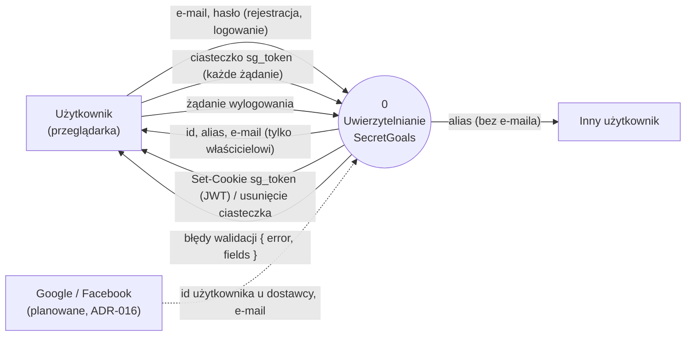
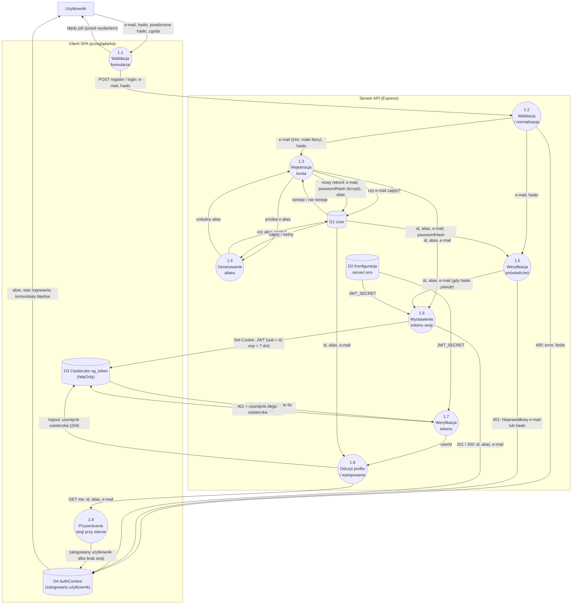
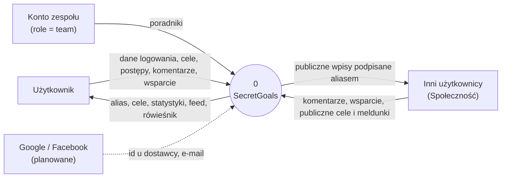
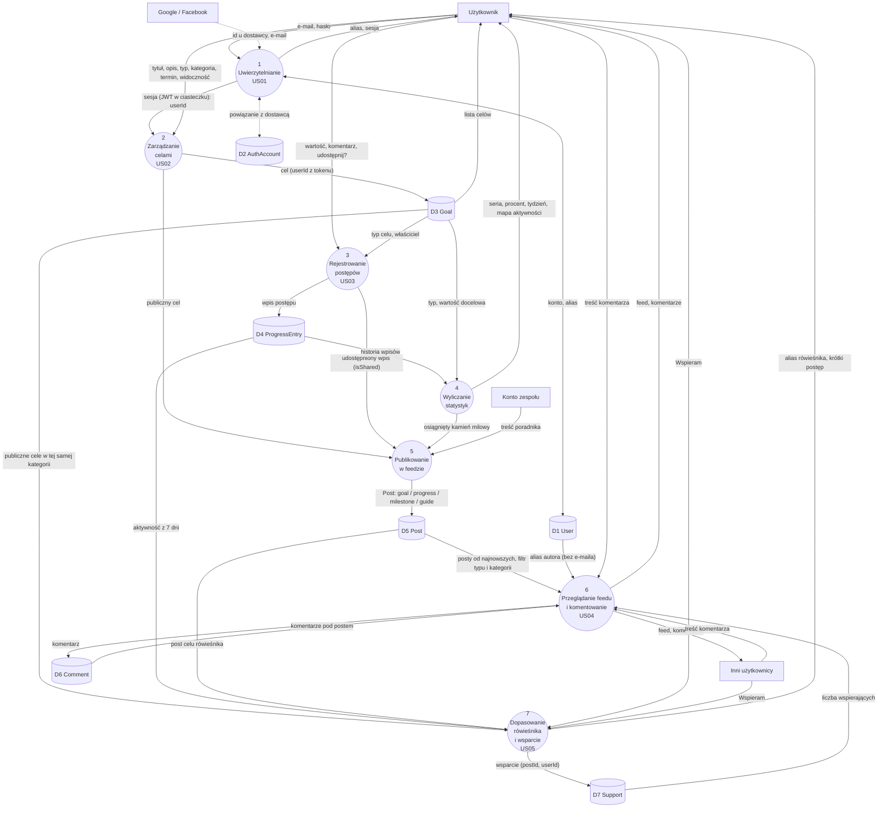

# Diagramy DFD – SecretGoals

Diagramy przepływu danych (DFD) uzupełniają ERD w **widoku danych** modelu 4+1. ERD pokazuje, co
przechowujemy, a DFD skąd dane przychodzą, jakie procesy je przekształcają, gdzie trafiają i czego
nigdy nie wysyłamy dalej.

- **Źródła:** kod US01 w `server/src/` (routes → controllers → services, ADR-005) i `client/src/`
  (`api/`, `context/`, `components/auth/`), decyzje w [`docs/ADR.md`](../ADR.md), historie w
  [`user_stories.md`](../user-stories_and_use-case/user_stories.md), model w [`ERD.md`](ERD.md).
- **Notacja** (Yourdon/DeMarco, narysowana w Mermaid `flowchart`):

| Kształt                     | Element DFD                                    | Przykład                    |
| :-------------------------- | :--------------------------------------------- | :-------------------------- |
| prostokąt                   | terminator (encja zewnętrzna)                  | Użytkownik, Google          |
| koło                        | proces (numerowany, np. `1.3`)                 | Rejestracja konta           |
| cylinder                    | magazyn danych (`D1`, `D2`, ...)               | `D1 User`                   |
| strzałka z opisem           | przepływ danych                                | `e-mail, hasło`             |
| prostokąt przerywany (ramka) | granica (przeglądarka / serwer)               | Klient SPA                  |

Plik ma dwie części: **szczegółowe DFD dla US01** (poziom 0 i poziom 1, zgodne z kodem po scaleniu
logowania) oraz **orientacyjne DFD całej aplikacji** (poziom 0 i poziom 1 na podstawie ADR,
historii i prototypów).

---

## 1. DFD dla US01 – rejestracja, logowanie i anonimowy alias

### 1.1 Poziom 0 (diagram kontekstowy)

Cały podsystem uwierzytelniania jako jeden proces. Inny użytkownik jest na diagramie celowo: z
US01 (scenariusz 2) wynika, że do niego płynie wyłącznie alias.

### 1.2 Poziom 1

Procesy odpowiadają funkcjom w kodzie (kolumna „Gdzie w kodzie” w tabeli 1.3). Magazyn `D3` to
ciasteczko w przeglądarce, a `D4` stan aplikacji w pamięci (React Context), bo z nich korzystają
procesy, choć nie są tabelami bazy.

### 1.3 Procesy

| Nr  | Proces                        | Wejście                                     | Wyjście                                           | Gdzie w kodzie                                                    |
| :-- | :---------------------------- | :------------------------------------------ | :------------------------------------------------ | :---------------------------------------------------------------- |
| 1.1 | Walidacja formularza          | e-mail, hasło, powtórzone hasło, zgoda      | dane do wysłania albo błędy pod polami            | `client/src/components/auth/AuthForm.tsx` (`validate`)            |
| 1.2 | Walidacja i normalizacja      | body żądania (`unknown`)                    | `{ email, password }` albo `400` z `fields`       | `server/src/utils/validation.ts` (`parseCredentials`)             |
| 1.3 | Rejestracja konta             | e-mail, hasło                               | nowy `User`; `409` przy zajętym e-mailu           | `server/src/services/authService.ts` (`registerUser`)             |
| 1.4 | Generowanie aliasu            | –                                           | unikalny alias, np. `CichyLis42`                  | `server/src/services/aliasService.ts` (`generateUniqueAlias`)     |
| 1.5 | Weryfikacja poświadczeń       | e-mail, hasło; rekord z `D1`                | użytkownik albo `null` (→ `401`)                  | `authService.ts` (`verifyCredentials`)                            |
| 1.6 | Wystawienie tokenu sesji      | `id`; `JWT_SECRET`                          | ciasteczko `sg_token` (JWT HS256, 7 dni)          | `authService.ts` (`signAuthToken`), `utils/authCookie.ts`         |
| 1.7 | Weryfikacja tokenu            | ciasteczko `sg_token`; `JWT_SECRET`         | `req.userId` albo `401`                           | `server/src/middleware/requireAuth.ts`                            |
| 1.8 | Odczyt profilu / wylogowanie  | `userId`; rekord z `D1`                     | `{ id, alias, email }` albo usunięte ciasteczko   | `controllers/authController.ts` (`me`, `logout`)                  |
| 1.9 | Przywrócenie sesji przy starcie | odpowiedź `GET /api/auth/me`              | `user` w `AuthContext` albo ekran logowania       | `client/src/context/AuthProvider.tsx`                             |

### 1.4 Magazyny danych

| Nr  | Magazyn                 | Gdzie                          | Zawartość                                         | Kto czyta / pisze                    |
| :-- | :---------------------- | :----------------------------- | :------------------------------------------------ | :----------------------------------- |
| D1  | `User`                  | SQLite (`server/prisma/dev.db`) | `id`, `email`, `passwordHash`, `alias`, `role`   | 1.3, 1.4 piszą/czytają; 1.5, 1.8 czytają |
| D2  | Konfiguracja serwera    | `server/.env` (poza repo)      | `JWT_SECRET`, `DATABASE_URL`, `PORT`              | 1.6, 1.7 czytają                     |
| D3  | Ciasteczko `sg_token`   | przeglądarka                   | JWT: `sub` (= `User.id`), `iat`, `exp`            | 1.6 zapisuje, 1.7 czyta, 1.8 i 1.7 usuwają |
| D4  | `AuthContext`           | pamięć aplikacji React         | `user` (`id`, `alias`, `email`), błędy, stan ładowania | 1.9 i odpowiedzi API zapisują, widoki czytają |

### 1.5 Ochrona danych w przepływach (ADR-007, ADR-008)

Zdecydowaliśmy się opisać wprost, czego w przepływach **nie ma**, bo to jest sedno US01:

- **Hasło w postaci jawnej** płynie tylko z formularza do procesów 1.2, 1.3 i 1.5 (przez HTTPS w
  produkcji). Nie trafia do żadnego magazynu ani do logów. Do `D1` trafia wyłącznie `passwordHash`.
- **`passwordHash`** płynie tylko z `D1` do procesu 1.5 i nigdy nie opuszcza serwera.
- **E-mail** wraca wyłącznie do właściciela konta (odpowiedzi rejestracji, logowania i `GET
  /api/auth/me`). Do innych użytkowników płynie tylko alias. Interfejs po zalogowaniu pokazuje alias,
  a e-maila nie wyświetla.
- **Token** leży w ciasteczku `httpOnly`, więc skrypt w przeglądarce nie może go odczytać. Klient zna
  stan logowania tylko z odpowiedzi API zapisanej w `D4`, nie z samego tokenu.
- **Odpowiedź na błędne logowanie** jest taka sama dla złego e-maila i złego hasła, a proces 1.5
  porównuje hasło z hashem zastępczym także wtedy, gdy konta nie ma. Z przepływu nie da się więc
  wywnioskować, czy e-mail jest zarejestrowany. Wyjątkiem jest rejestracja, która musi zwrócić
  `409` przy zajętym e-mailu (świadomy kompromis US01).

### 1.6 Przepływy dla poszczególnych scenariuszy

| Scenariusz                         | Ścieżka przez procesy                    | Wynik                                                |
| :--------------------------------- | :--------------------------------------- | :--------------------------------------------------- |
| Rejestracja (US01, scenariusz 1)    | 1.1 → 1.2 → 1.3 ↔ 1.4 → 1.6 → `D3`, `D4` | `201`, konto z aliasem, użytkownik od razu zalogowany |
| Rejestracja na zajęty e-mail       | 1.1 → 1.2 → 1.3                          | `409`, komunikat pod polem e-mail                    |
| Logowanie                          | 1.1 → 1.2 → 1.5 → 1.6 → `D3`, `D4`       | `200`, ciasteczko ustawione                          |
| Błędne logowanie                   | 1.1 → 1.2 → 1.5                          | `401`, wspólny komunikat                             |
| Powrót do aplikacji                | `D3` → 1.7 → 1.8 → 1.9 → `D4`            | użytkownik zalogowany bez ponownego logowania        |
| Wylogowanie                        | 1.7 → 1.8 → `D3`                         | `204`, ciasteczko usunięte, `D4` wyczyszczony        |
| Profil oglądany przez innego (scenariusz 2) | `D1` → (przyszły proces profilu) → inny użytkownik | tylko alias, bez e-maila                   |

---

## 2. DFD całej aplikacji (orientacyjny)

Ta część opisuje docelowe przepływy dla US01–US05 na podstawie ADR-006, ADR-007, ADR-011 i ADR-012
oraz prototypu v2. Poza US01 i podstawową obsługą celów kod jeszcze nie istnieje, więc numeracja i
podział procesów mogą się zmienić przy implementacji.

### 2.1 Poziom 0 (diagram kontekstowy)

### 2.2 Poziom 1

### 2.3 Procesy

| Nr  | Proces                          | Historia   | Endpointy (ADR-006)                                         | Stan w kodzie          |
| :-- | :------------------------------ | :--------- | :---------------------------------------------------------- | :--------------------- |
| 1   | Uwierzytelnianie                | US01       | `/api/auth/register`, `login`, `logout`, `me`; OAuth z ADR-016 | e-mail i hasło: tak; OAuth: nie |
| 2   | Zarządzanie celami              | US02       | `GET`, `POST /api/goals`, `PATCH`, `DELETE /api/goals/:id`  | częściowo (`GET`, `POST`) |
| 3   | Rejestrowanie postępów          | US03       | `POST /api/goals/:id/progress`                              | nie                    |
| 4   | Wyliczanie statystyk            | US03       | w odpowiedziach celów (seria, procent)                      | nie                    |
| 5   | Publikowanie w feedzie          | US04, US05 | wewnętrzny (serwisy), poradniki przez konto zespołu        | nie                    |
| 6   | Przeglądanie feedu i komentowanie | US04     | `GET /api/feed`, `GET`, `POST /api/posts/:id/comments`      | nie                    |
| 7   | Dopasowanie rówieśnika i wsparcie | US05     | `GET /api/goals/:id/peer`, `POST /api/posts/:id/support`    | nie                    |

### 2.4 Reguły przepływów w całej aplikacji

- **Właściciel danych zawsze pochodzi z sesji** (proces 1), a nie z treści żądania (ADR-008). Dlatego
  procesy 2, 3, 6 i 7 dostają `userId` od procesu 1.
- **Do innych użytkowników płynie tylko alias.** Procesy 6 i 7 czytają z `D1` wyłącznie `id` i
  `alias` (ADR-007).
- **Prywatne cele nie wychodzą poza właściciela.** Proces 5 publikuje tylko cele z `isPublic = true`,
  a proces 7 dobiera rówieśnika tylko z publicznych celów. Zmiana celu na prywatny usuwa jego posty
  z `D5` (ADR-011).
- **Feed zasila jedna tabela.** Wszystko, co widać w Społeczności, przechodzi przez proces 5 do `D5`,
  a komentarze (`D6`) i wsparcie (`D7`) zawsze wskazują na post. Nowy rodzaj wpisu nie zmienia
  procesów 6 i 7.
- **Statystyki nie są zapisywane.** Proces 4 liczy je przy każdym odczycie z `D4`, więc nie ma
  przepływu „seria” do żadnego magazynu.
