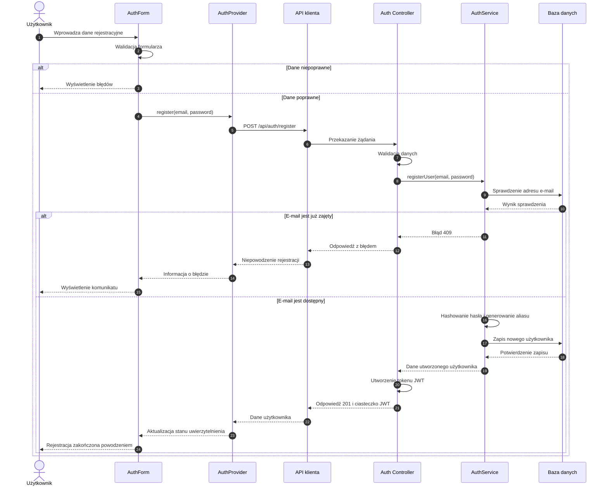
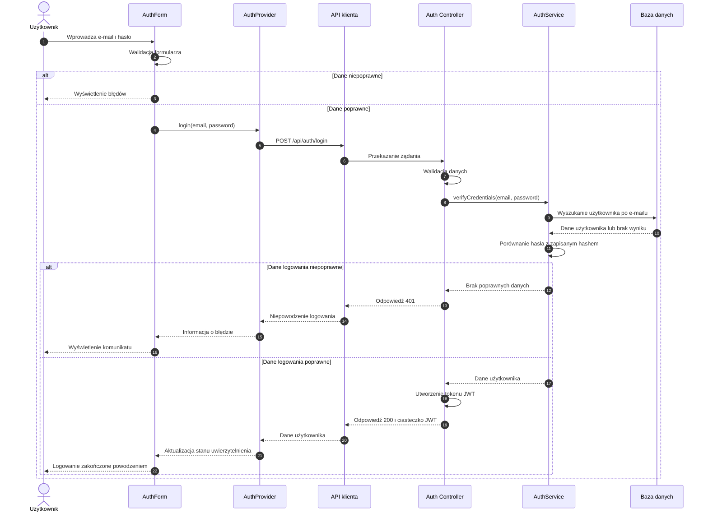

# Diagram procesów – diagram komunikacji i diagram sekwencji

## Uczestnicy procesu

| Uczestnik | Rola |
|---|---|
| Użytkownik | Wprowadza dane rejestracyjne lub logowania. |
| Formularz AuthForm | Pobiera dane i wykonuje walidację po stronie frontendowej. |
| AuthProvider | Udostępnia funkcje rejestracji i logowania oraz aktualizuje stan zalogowanego użytkownika. |
| API klienta | Wysyła żądania HTTP do backendu, z obsługą ciasteczek. |
| Auth Routes / Controller | Odbiera żądanie, sprawdza dane wejściowe i obsługuje odpowiedź HTTP. |
| AuthService | Weryfikuje dane logowania lub tworzy konto użytkownika. |
| Baza danych | Przechowuje dane użytkownika, w tym adres e-mail i hash hasła. |

## UML Communication Diagram – diagram komunikacji

Diagram komunikacji pokazuje, które elementy systemu współpracują ze sobą. Numery przy komunikatach wskazują kolejność wywołań w ramach danego wariantu procesu.

```mermaid
flowchart LR
    U["Użytkownik"]
    F["AuthForm<br/>formularz"]
    P["AuthProvider"]
    API["API klienta"]
    C["Auth Controller<br/>i Auth Routes"]
    S["AuthService"]
    DB[("Baza danych")]

    U -->|"1. Wprowadzenie danych"| F
    F -->|"2. Wywołanie register() lub login()"| P
    P -->|"3. Wysłanie żądania HTTP"| API
    API -->|"4. POST /api/auth/register<br/>lub POST /api/auth/login"| C
    C -->|"5. registerUser() lub verifyCredentials()"| S
    S -->|"6. Odczyt / zapis danych użytkownika"| DB
    DB -->|"7. Wynik operacji"| S
    S -->|"8. Wynik weryfikacji lub utworzenia konta"| C
    C -->|"9. Odpowiedź HTTP i ustawienie cookie JWT<br/>(błąd: odpowiedni status HTTP)"| API
    API -->|"10. Wynik żądania"| P
    P -->|"11. Aktualizacja stanu użytkownika"| F
    F -->|"12. Informacja o wyniku"| U
```

### 3.1. Opis komunikatów

| Nr | Nadawca → odbiorca | Komunikat / działanie |
|---:|---|---|
| 1 | Użytkownik → AuthForm | Użytkownik wpisuje e-mail i hasło. Przy rejestracji podaje również potwierdzenie hasła i akceptuje regulamin. |
| 2 | AuthForm → AuthProvider | Formularz wywołuje funkcję `register()` albo `login()`. |
| 3 | AuthProvider → API klienta | Rozpoczyna się wysyłanie żądania do backendu. |
| 4 | API klienta → Auth Controller | Wysyłane jest żądanie `POST /api/auth/register` albo `POST /api/auth/login`. |
| 5 | Controller → AuthService | Dla rejestracji wywoływana jest metoda `registerUser()`, a dla logowania `verifyCredentials()`. |
| 6–7 | AuthService ↔ Baza danych | Podczas rejestracji sprawdzany jest e-mail i zapisywany nowy użytkownik; podczas logowania pobierane są dane użytkownika potrzebne do weryfikacji hasła. |
| 8 | AuthService → Controller | Przekazywany jest wynik operacji. |
| 9–10 | Controller → API klienta | Backend zwraca odpowiedź HTTP. Przy powodzeniu ustawia ciasteczko zawierające token JWT. W przypadku błędu zwraca odpowiedni status. |
| 11 | AuthProvider → interfejs | Po udanej operacji aktualizowany jest stan zalogowanego użytkownika. |
| 12 | AuthForm → Użytkownik | Interfejs prezentuje wynik operacji. |

## UML Sequence Diagram – diagram sekwencji

Dla większej czytelności przebieg rejestracji i logowania przedstawiono na dwóch osobnych diagramach.

### Rejestracja

### Logowanie

## Warunki i rezultaty procesu

| Element | Rejestracja | Logowanie |
|---|---|---|
| Dane wejściowe | E-mail, hasło, potwierdzenie hasła, akceptacja regulaminu | E-mail i hasło |
| Walidacja frontendowa | Poprawność e-maila, wymagane hasło, minimum 8 znaków i cyfra, zgodność haseł, akceptacja regulaminu | Poprawność e-maila i obecność hasła |
| Walidacja backendowa | Sprawdzenie danych oraz dostępności adresu e-mail | Sprawdzenie danych i weryfikacja hasła |
| Sukces | Utworzenie użytkownika, wygenerowanie aliasu i ustawienie ciasteczka JWT | Ustawienie ciasteczka JWT po poprawnej weryfikacji |
| Przykładowy błąd | Niepoprawne dane lub zajęty e-mail (409) | Niepoprawne dane logowania (401) |

## Uwagi dotyczące implementacji

- Hasło nie jest zapisywane w bazie danych w postaci jawnej. Backend zapisuje jego hash wygenerowany z użyciem bcrypt.
- Unikalny alias użytkownika jest generowany po stronie backendu podczas rejestracji. Podgląd aliasu w formularzu ma charakter przykładowy.
- Po udanej rejestracji użytkownik zostaje automatycznie zalogowany.
- Token JWT jest przekazywany w ciasteczku uwierzytelniającym.
- Żądania klienta są wysyłane z obsługą ciasteczek (`credentials: 'include'`).

