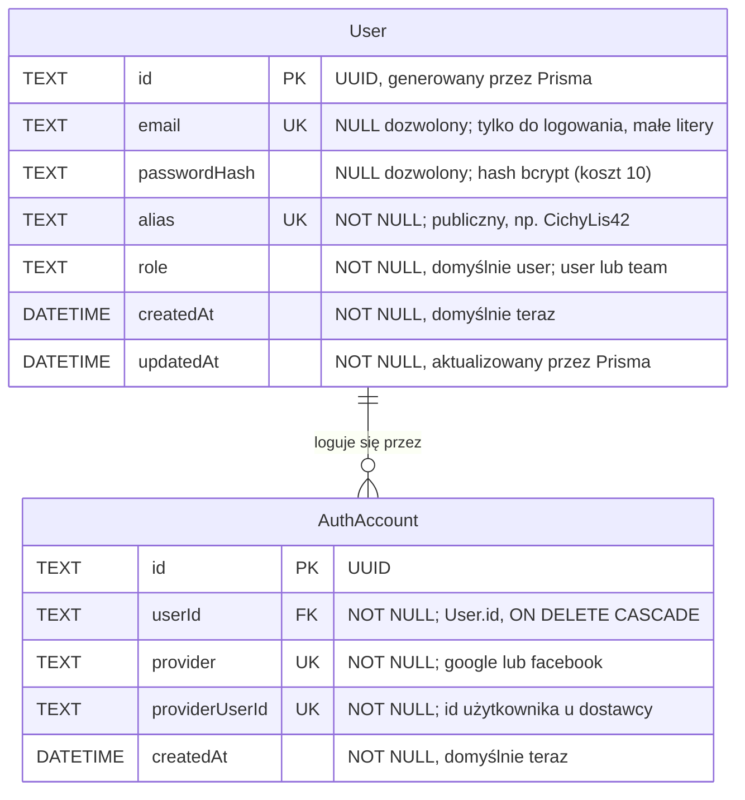
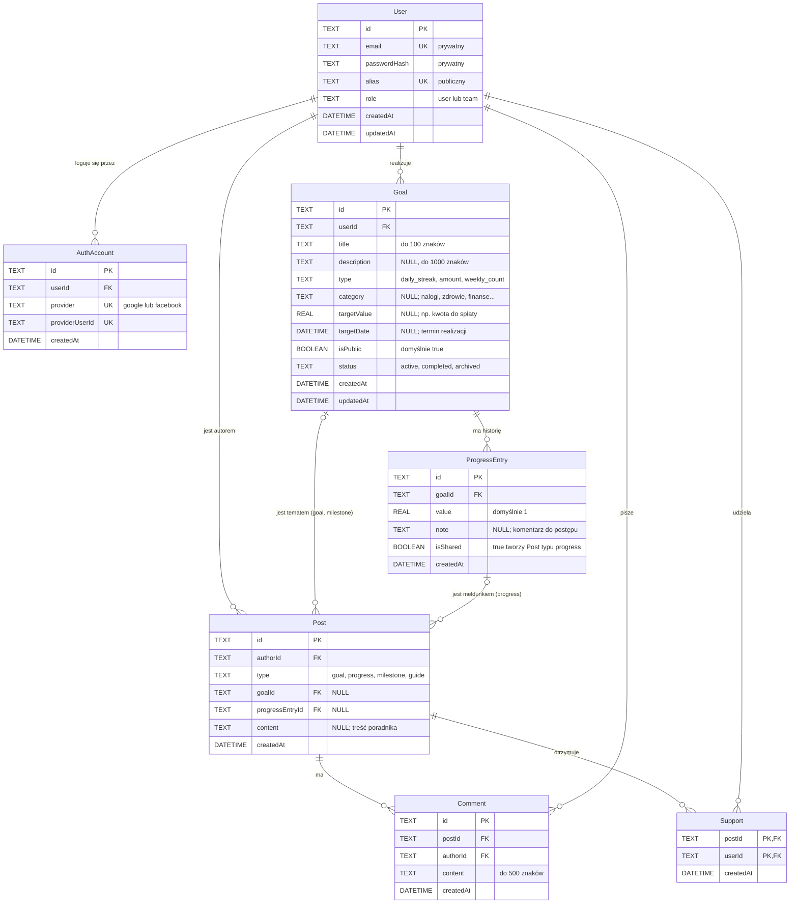

# Diagramy ERD – SecretGoals

Diagramy związków encji (ERD) to część **widoku danych** w modelu 4+1 (obok widoku logicznego).
Pokazujemy na nich, jakie dane przechowujemy w bazie i jak są ze sobą powiązane.

- **Źródło prawdy:** [`server/prisma/schema.prisma`](../../server/prisma/schema.prisma) oraz migracja
  [`20261031182011_init`](../../server/prisma/migrations/20261031182011_init/migration.sql). Gdy schemat się
  zmienia (ADR-010), aktualizujemy też ten plik.
- **Decyzje, z których wynika model:** ADR-004 (SQLite + Prisma), ADR-007 (anonimowość), ADR-008
  (logowanie), ADR-011 (model danych i feed), ADR-016 (Google/Facebook) w [`docs/ADR.md`](../ADR.md).
- **Notacja:** „kurza łapka” (crow's foot) w składni Mermaid `erDiagram`, renderowana bezpośrednio
  przez GitHub. `PK` to klucz główny, `FK` klucz obcy, `UK` wartość unikalna.

| Symbol na linii | Znaczenie         |
| :-------------- | :---------------- |
| `\|\|`          | dokładnie jeden   |
| `o\|`           | zero albo jeden   |
| `o{`            | zero lub wiele    |
| `\|{`           | jeden lub wiele   |

Plik ma dwie części: **szczegółowy ERD dla US01** (rejestracja i logowanie, już wdrożone) oraz
**orientacyjny ERD całej aplikacji** (cały schemat z ADR-011, którego większość dopiero będziemy
wykorzystywać w kolejnych historiach).

---

## 1. ERD dla US01 – rejestracja, logowanie i anonimowy alias

### 1.1 Diagram

US01 korzysta z dwóch tabel: `User` (konto i alias) oraz `AuthAccount` (powiązanie konta z
Google/Facebookiem). Tabela `AuthAccount` jest już w schemacie, ale wypełni ją dopiero logowanie
przez dostawców zewnętrznych (ADR-016, jeszcze niewdrożone).

Para `provider` + `providerUserId` jest unikalna razem (jeden indeks złożony), a nie każda kolumna
osobno.

### 1.2 Atrybuty tabeli `User`

| Kolumna        | Typ (SQLite) | Null | Domyślnie           | Ograniczenia               | Opis                                                                                                                    |
| :------------- | :----------- | :--- | :------------------ | :------------------------- | :---------------------------------------------------------------------------------------------------------------------- |
| `id`           | `TEXT`       | nie  | `uuid()` (Prisma)   | `PRIMARY KEY`              | Identyfikator konta. UUID, żeby z adresu nie dało się odczytać liczby kont (ADR-004). Trafia do JWT jako `sub`.         |
| `email`        | `TEXT`       | tak  | –                   | `UNIQUE` (`User_email_key`) | Login. Serwer przycina go i zamienia na małe litery przed zapisem. Pusty dla konta z Facebooka bez e-maila (ADR-016). |
| `passwordHash` | `TEXT`       | tak  | –                   | –                          | Hash bcrypt (`bcryptjs`, koszt 10). Hasła w postaci jawnej nie zapisujemy nigdzie. Pusty dla kont Google/Facebook.      |
| `alias`        | `TEXT`       | nie  | –                   | `UNIQUE` (`User_alias_key`) | Publiczna tożsamość: przymiotnik + rzeczownik + liczba (2 lub 4 cyfry). Generuje go serwer (`aliasService`).          |
| `role`         | `TEXT`       | nie  | `'user'`            | wartości: `user`, `team`   | Konto zespołu (`team`) może dodawać poradniki. SQLite nie ma enumów, więc to tekst (ADR-004).                           |
| `createdAt`    | `DATETIME`   | nie  | `CURRENT_TIMESTAMP` | –                          | Data założenia konta.                                                                                                   |
| `updatedAt`    | `DATETIME`   | nie  | ustawia Prisma      | `@updatedAt`               | Data ostatniej zmiany (np. przyszłe losowanie nowego aliasu).                                                           |

### 1.3 Atrybuty tabeli `AuthAccount`

| Kolumna          | Typ (SQLite) | Null | Ograniczenia                                                    | Opis                                         |
| :--------------- | :----------- | :--- | :-------------------------------------------------------------- | :------------------------------------------- |
| `id`             | `TEXT`       | nie  | `PRIMARY KEY`                                                   | UUID.                                        |
| `userId`         | `TEXT`       | nie  | `FOREIGN KEY → User.id`, `ON DELETE CASCADE`, indeks `userId`   | Właściciel powiązania.                       |
| `provider`       | `TEXT`       | nie  | `UNIQUE (provider, providerUserId)`; wartości `google`, `facebook` | Dostawca logowania.                       |
| `providerUserId` | `TEXT`       | nie  | jw.                                                             | Identyfikator użytkownika u dostawcy.        |
| `createdAt`      | `DATETIME`   | nie  | domyślnie `CURRENT_TIMESTAMP`                                   | Data połączenia konta z dostawcą.            |

### 1.4 Reguły danych w US01

- **Dwie warstwy danych konta (ADR-007).** Warstwa prywatna to `email`, `passwordHash` i
  `AuthAccount`. Warstwa publiczna to `alias` (i `id`). Inni użytkownicy dostają wyłącznie warstwę
  publiczną. Serwis wybiera pola jawnie (`select: { id, alias, email }` tylko dla właściciela konta),
  a `passwordHash` nigdy nie opuszcza serwera.
- **Konto ma co najmniej jedną metodę logowania.** Albo `email` + `passwordHash`, albo rekord w
  `AuthAccount`. Baza tego nie wymusza (oba pola `User` są opcjonalne), pilnuje tego serwis.
- **Unikalność aliasu** zapewniają razem serwis (sprawdza wylosowany alias przed zapisem, do 20 prób)
  i indeks `UNIQUE` w bazie (przy kolizji w tej samej chwili serwis losuje jeszcze raz, do 3 razy).
- **Unikalność e-maila** sprawdza serwis przed zapisem (`409`), a indeks `UNIQUE` chroni przed
  dwiema równoczesnymi rejestracjami.
- **Sesja nie jest encją.** Zdecydowaliśmy się na JWT w ciasteczku `sg_token` (ADR-008), więc w bazie
  nie ma tabeli sesji. Token zawiera tylko `sub` (= `User.id`), `iat` i `exp` (7 dni) i jest
  podpisany sekretem `JWT_SECRET` z `server/.env`. Na diagramie DFD pokazujemy go jako przepływ danych
  i magazyn po stronie przeglądarki, a nie jako tabelę.
- **Usunięcie konta** usuwa kaskadowo jego powiązania `AuthAccount` (oraz, w całym modelu, cele,
  wpisy, posty, komentarze i wsparcie, patrz sekcja 2).

---

## 2. ERD całej aplikacji (orientacyjny)

Ten diagram pokazuje pełny model z ADR-011, który już jest w migracji `init`. Część tabel nie ma
jeszcze kodu, który je wypełnia, więc nazwy pól i reguły mogą się zmienić przy implementacji
kolejnych historii (każda zmiana przez nową migrację, ADR-010).

| Tabela          | Historia   | Stan w kodzie (1.11.2026)                                 |
| :-------------- | :--------- | :-------------------------------------------------------- |
| `User`          | US01       | używana: rejestracja, logowanie, `/api/auth/me`           |
| `AuthAccount`   | US01       | tylko w schemacie (czeka na ADR-016)                      |
| `Goal`          | US02, US05 | częściowo: `GET` i `POST /api/goals` (bez typu i kategorii) |
| `ProgressEntry` | US03       | tylko w schemacie                                         |
| `Post`          | US04, US05 | tylko w schemacie                                         |
| `Comment`       | US04       | tylko w schemacie                                         |
| `Support`       | US05       | tylko w schemacie                                         |

### 2.1 Diagram

Dla czytelności pokazujemy klucze i najważniejsze pola. Pełne typy i ograniczenia są w schemacie
Prisma.

### 2.2 Związki

| Związek                   | Liczność | Klucz obcy                         | Przy usunięciu rodzica | Znaczenie                                                        |
| :------------------------ | :------- | :--------------------------------- | :--------------------- | :--------------------------------------------------------------- |
| `User` – `AuthAccount`    | 1 : N    | `AuthAccount.userId`               | kaskada                | konto może mieć logowanie przez Google i Facebook naraz          |
| `User` – `Goal`           | 1 : N    | `Goal.userId`                      | kaskada                | każdy cel ma właściciela (z tokenu, nigdy z body, ADR-008)       |
| `Goal` – `ProgressEntry`  | 1 : N    | `ProgressEntry.goalId`             | kaskada                | historia postępów; z niej liczymy serię i procent                |
| `User` – `Post`           | 1 : N    | `Post.authorId`                    | kaskada                | autor wpisu w feedzie                                            |
| `Goal` – `Post`           | 0..1 : N | `Post.goalId` (opcjonalny)         | kaskada                | post „nowy cel” i „kamień milowy” wskazują cel                   |
| `ProgressEntry` – `Post`  | 0..1 : N | `Post.progressEntryId` (opcjonalny) | kaskada               | meldunek z udostępnionego postępu                                |
| `Post` – `Comment`        | 1 : N    | `Comment.postId`                   | kaskada                | komentarze zawsze wskazują post, niezależnie od jego typu        |
| `User` – `Comment`        | 1 : N    | `Comment.authorId`                 | kaskada                | autor komentarza (pokazywany tylko aliasem)                      |
| `User` – `Post` (wsparcie) | M : N   | tabela `Support`                   | kaskada                | „Wspieram”; klucz złożony `(postId, userId)` blokuje duplikaty   |

`Support` jest encją asocjacyjną: rozbija związek wiele-do-wielu między użytkownikami a postami, a
jej klucz główny `(postId, userId)` sprawia, że jeden użytkownik wspiera dany post najwyżej raz
(US05, scenariusz 2).

### 2.3 Typy wpisów w feedzie (`Post.type`)

Zdecydowaliśmy, że feed to jedna tabela `Post` z polem `type` (ADR-011). Od typu zależy, które
opcjonalne pola są wypełnione:

| `type`      | `goalId` | `progressEntryId` | `content` | Kto tworzy                                          |
| :---------- | :------: | :---------------: | :-------: | :-------------------------------------------------- |
| `goal`      |    ✓     |         –         |     –     | serwis, przy zapisie publicznego celu               |
| `progress`  |    –     |         ✓         |     –     | serwis, przy wpisie postępu z `isShared = true`     |
| `milestone` |    ✓     |         –         |     –     | serwis, gdy cel osiągnie kamień milowy              |
| `guide`     |    –     |         –         |     ✓     | konto zespołu (`User.role = 'team'`)                |

Baza nie wymusza tych kombinacji (wszystkie trzy pola są opcjonalne), sprawdza je walidacja w
serwisie (ADR-009).

### 2.4 Dane wyliczane (nie zapisujemy ich w tabelach)

- **Seria, najdłuższa seria, dni w tym tygodniu, procent realizacji, mapa aktywności** – liczone z
  `ProgressEntry` (i `Goal.type`, `Goal.targetValue`) przy odczycie. Licznika serii w `Goal` celowo
  nie ma, żeby nie rozjechał się z historią (ADR-011).
- **Liczba wspierających i komentarzy pod postem** – `COUNT` na `Support` i `Comment`.
- **Rówieśnik (US05)** – wybierany przy odczycie z publicznych celów innych użytkowników w tej samej
  kategorii, z wpisem postępu z ostatnich 7 dni (ADR-012).

### 2.5 Indeksy

| Indeks                                   | Po co                                                    |
| :--------------------------------------- | :------------------------------------------------------- |
| `User(email)`, `User(alias)` – unikalne  | logowanie po e-mailu, unikalny alias                     |
| `AuthAccount(provider, providerUserId)` – unikalny | odnalezienie konta po powrocie od dostawcy     |
| `AuthAccount(userId)`, `Goal(userId)`    | lista powiązań i celów użytkownika                       |
| `Goal(category, isPublic)`               | dopasowanie rówieśnika i filtr „Podobne cele”            |
| `ProgressEntry(goalId, createdAt)`       | historia postępów celu w kolejności (seria, statystyki)  |
| `Post(createdAt)`, `Post(type, createdAt)` | feed od najnowszych, filtr „Kamienie milowe”, „Poradniki” |
| `Comment(postId, createdAt)`             | komentarze pod postem w kolejności                       |

### 2.6 Możliwa rozbudowa

Nowy rodzaj wpisu (np. rolka z wideo, ankieta) to nowa wartość `Post.type` i ewentualnie osobna
tabela powiązana z `Post` (np. `PostMedia`), bez zmian w `Comment` i `Support` (ADR-011). Takich
tabel jeszcze nie ma w schemacie, więc nie pokazujemy ich na diagramie.
