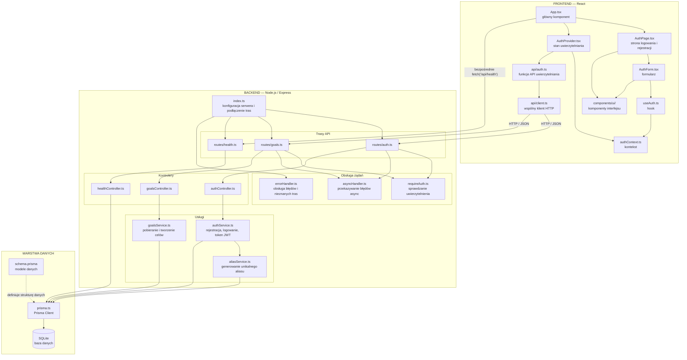

# Diagram struktury systemu SecretGoals

Diagram przedstawia **aktualną implementację widoczną w przesłanym projekcie**. Pokazuje istniejące moduły i zależności, a nie docelowe funkcje, które są jeszcze tylko zaplanowane.

## Opis elementów

### Frontend

| Element | Rola |
|---|---|
| `App.tsx` | Główny komponent aplikacji. Korzysta z kontekstu uwierzytelniania i wyświetla stronę logowania albo widok po zalogowaniu. Sprawdza też stan serwera przez bezpośrednie `fetch('/api/health')`. |
| `AuthPage.tsx` | Strona logowania i rejestracji. |
| `AuthForm.tsx` | Formularz, walidacja danych po stronie interfejsu i wywołanie funkcji logowania lub rejestracji z hooka. |
| `useAuth.ts` | Hook udostępniający komponentom dane i funkcje z kontekstu uwierzytelniania. |
| `AuthProvider.tsx` | Zarządza stanem użytkownika, sprawdza sesję po uruchomieniu aplikacji oraz udostępnia funkcje logowania, rejestracji i wylogowania. |
| `authContext.ts` | Definiuje kontekst i typ udostępnianych danych uwierzytelniania. |
| `api/auth.ts` | Funkcje wywołujące endpointy rejestracji, logowania, wylogowania i pobrania danych zalogowanego użytkownika. |
| `api/client.ts` | Wspólna funkcja `apiRequest`, która wykonuje żądania HTTP i obsługuje odpowiedzi oraz błędy API. |
| `components/ui/` | Współdzielone elementy interfejsu, np. przyciski, pola tekstowe, karty i awatary. |

### Backend

| Element | Rola |
|---|---|
| `index.ts` | Tworzy aplikację Express, konfiguruje middleware i podłącza trasy pod adresami `/api/health`, `/api/auth` i `/api/goals`. |
| `routes/auth.ts` | Definiuje endpointy rejestracji, logowania, wylogowania i pobierania danych zalogowanego użytkownika. |
| `routes/goals.ts` | Definiuje endpointy pobierania i tworzenia celów. Wszystkie trasy w tym routerze wymagają uwierzytelnienia. |
| `routes/health.ts` | Definiuje endpoint sprawdzający stan serwera i połączenia z bazą. |
| `requireAuth.ts` | Sprawdza token JWT zapisany w ciasteczku i udostępnia identyfikator zalogowanego użytkownika. |
| `asyncHandler.ts` | Przekazuje błędy z asynchronicznych kontrolerów do obsługi błędów Express. |
| `errorHandler.ts` | Obsługuje nieznane trasy API i błędy zwracane przez backend. |
| `authController.ts` | Obsługuje żądania uwierzytelniania i korzysta z `authService`. |
| `goalsController.ts` | Obsługuje żądania dotyczące celów i korzysta z `goalsService`. |
| `healthController.ts` | Sprawdza połączenie z bazą danych, wykonując zapytanie przez Prisma Client. |
| `authService.ts` | Realizuje logikę rejestracji, weryfikacji danych logowania i obsługi tokenów JWT. |
| `aliasService.ts` | Generuje losowy, unikalny alias użytkownika i sprawdza jego dostępność w bazie. |
| `goalsService.ts` | Odczytuje cele użytkownika i tworzy nowe cele. |

### Warstwa danych

| Element | Rola |
|---|---|
| `prisma.ts` | Tworzy i udostępnia instancję Prisma Client. |
| `schema.prisma` | Definiuje modele i relacje danych wykorzystywane przez Prisma. |
| SQLite | Relacyjna baza danych wskazana w konfiguracji Prisma. |

## Ważne uwagi o zgodności z kodem

- `AuthProvider` korzysta z `api/auth.ts`, a ten moduł korzysta ze wspólnego klienta `api/client.ts`.
- Sprawdzenie stanu serwera w `App.tsx` wykonuje **bezpośrednie** `fetch('/api/health')` — nie przechodzi przez `api/client.ts`.
- `requireAuth` jest używany dla `GET /api/auth/me` oraz dla wszystkich endpointów w `routes/goals.ts`. Rejestracja, logowanie i wylogowanie nie wymagają wcześniejszego zalogowania.
- `healthController.ts` korzysta bezpośrednio z Prisma Client; w tej ścieżce nie ma osobnej usługi.
- W backendzie istnieją endpointy pobierania i tworzenia celów, ale aktualny widok celów w `App.tsx` zawiera przykładowe, zapisane w kodzie dane. W przesłanym frontendzie nie ma jeszcze modułu API wywołującego endpointy `/api/goals`.
- `schema.prisma` zawiera również modele `ProgressEntry`, `Post`, `Comment`, `Support` i `AuthAccount`. Samo istnienie modeli w schemacie nie oznacza, że odpowiadające im funkcje API są już zaimplementowane.
- Diagram pokazuje zależności modułów, a nie pełny przebieg pojedynczego procesu, np. rejestracji użytkownika.
