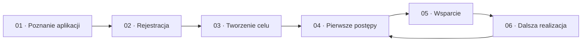
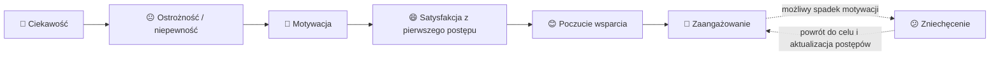
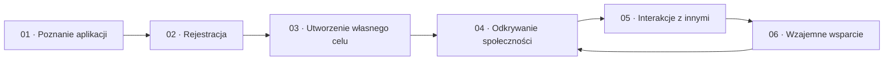
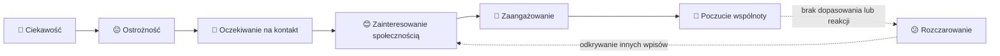

# User Journey Map — Persona 01 i Persona 02

## Secret Goals

Dokument przedstawia dwie hipotetyczne proto-persony oparte na różnych potrzebach użytkowników aplikacji Secret Goals. Każda persona ma własną mapę podróży użytkownika, obejmującą działania, punkty styku z aplikacją (powiązane z makietami High-Fi oraz przepływami w repozytorium), przewidywane emocje, punkty bólu i możliwości usprawnień.

- **Makiety High-Fi i design system:** [`docs/design/mockups/README.md`](../design/mockups/README.md)
- **User Flows:** [`docs/prototypes/user-flows/README.md`](../prototypes/user-flows/README.md)

**Ważne:** persony mają charakter roboczy (proto-persony). Zostały opracowane na podstawie założeń projektu, User Stories US01–US05, przypadków użycia, funkcjonalności aplikacji oraz dostępnych makiet High-Fi i User Flows. Nie są wynikiem badań z użytkownikami. Celowo nie przypisujemy im niepotwierdzonych danych demograficznych, imion, awatarów ani cytatów. Różnią się przede wszystkim główną potrzebą i priorytetem korzystania z aplikacji — jedna rzeczywista osoba może odpowiadać obu profilom.

------------------------------------------------------------------------

# Persona 01 — Osoba realizująca własny cel

## 1. Charakterystyka persony

**Opis**

Użytkownik, który chce osiągnąć osobisty cel lub wyrobić nowy nawyk. Potrzebuje miejsca, w którym może określić swój cel, zapisywać postępy i obserwować efekty swoich działań. Może mieć trudności z utrzymaniem regularności, dlatego przydatne są dla niego rozwiązania wspierające motywację. Istotna jest również możliwość korzystania z aplikacji bez ujawniania swojej tożsamości innym użytkownikom.

| Obszar                       | Charakterystyka                                                                                                         |
|:-----------------------------|:------------------------------------------------------------------------------------------------------------------------|
| Główny cel                   | Osiągnięcie wybranego celu lub utrwalenie nawyku.                                                                       |
| Potrzeby                     | Utworzenie i monitorowanie celu, łatwe zapisywanie postępów, zachowanie anonimowości oraz możliwość uzyskania wsparcia. |
| Motywacje                    | Chęć wprowadzenia zmiany, obserwowania własnych postępów i utrzymania zaangażowania.                                    |
| Potencjalne trudności        | Nieregularność, spadek motywacji, trudność w dostrzeganiu postępów.                                                     |
| Obawy                        | Ujawnienie tożsamości oraz brak wsparcia lub osoby o podobnym celu.                                                     |
| Oczekiwana wartość aplikacji | Możliwość samodzielnej realizacji celu, śledzenia postępów i korzystania ze wsparcia w anonimowym środowisku.           |

## 2. Cel i etapy podróży

- **Główny cel podróży (perspektywa użytkownika):** rozpocząć realizację osobistego celu w Secret Goals, monitorować postępy i utrzymywać motywację, korzystając w razie potrzeby ze wsparcia społeczności — bez ujawniania swojej tożsamości.
- **Cel biznesowy:** pozyskanie aktywnego, powracającego użytkownika, który definiuje własny cel i regularnie rejestruje postępy w aplikacji (budowanie retencji i nawyku korzystania z produktu).

Podróż przedstawia podstawową ścieżkę użytkownika: od poznania aplikacji, przez założenie konta i utworzenie celu, po regularne monitorowanie postępów. Wsparcie innych użytkowników jest dodatkową możliwością, z której persona może skorzystać, ale nie jest warunkiem realizacji głównego celu.

## 3. Mapa User Journey

### Etapy 1–3: rozpoczęcie korzystania z aplikacji

| Kategoria         | 1\. Poznanie aplikacji                                                                            | 2\. Rejestracja                                                                                      | 3\. Tworzenie celu                                                              |
|:------------------|:--------------------------------------------------------------------------------------------------|:-----------------------------------------------------------------------------------------------------|:--------------------------------------------------------------------------------|
| **Actions**       | Zapoznaje się z przeznaczeniem aplikacji i sprawdza, czy może realizować cele w anonimowy sposób. | Wybiera rejestrację, podaje adres e-mail i hasło, a następnie zakłada konto. Otrzymuje losowy alias. | Przechodzi do sekcji „Cele”, otwiera formularz i podaje nazwę, kategorię, typ, termin oraz widoczność celu. |
| **Touchpoints**   | **Makiety High-Fi:** `01-logowanie` ([mobile](../design/mockups/mobile/01-logowanie.png), [desktop](../design/mockups/desktop/01-logowanie.png)), `02-rejestracja` ([mobile](../design/mockups/mobile/02-rejestracja.png), [desktop](../design/mockups/desktop/02-rejestracja.png)) ([`Flow-01-Rejestracja.dc.html`](../prototypes/user-flows/flows/Flow-01-Rejestracja.dc.html), [`Flow-02-Logowanie.dc.html`](../prototypes/user-flows/flows/Flow-02-Logowanie.dc.html)). W dokumentacji brak dedykowanego ekranu „o aplikacji” przed rejestracją. | **Makiety High-Fi:** `02-rejestracja` ([mobile](../design/mockups/mobile/02-rejestracja.png), [desktop](../design/mockups/desktop/02-rejestracja.png)), `03-powitanie` ([mobile](../design/mockups/mobile/03-powitanie.png), [desktop](../design/mockups/desktop/03-powitanie.png)) z wygenerowanym aliasem; **stany:** [`S-auth-rej-walidacja`](../prototypes/user-flows/stany/S-auth-rej-walidacja.dc.html), [`S-auth-rej-zajety`](../prototypes/user-flows/stany/S-auth-rej-zajety.dc.html) ([`Flow-01-Rejestracja.dc.html`](../prototypes/user-flows/flows/Flow-01-Rejestracja.dc.html) – kody błędów 400/409/500). | **Makiety High-Fi:** `03-powitanie` („Dodaj pierwszy cel”: [mobile](../design/mockups/mobile/03-powitanie.png), [desktop](../design/mockups/desktop/03-powitanie.png)), `05-nowy-cel` ([mobile](../design/mockups/mobile/05-nowy-cel.png), [mobile – cały formularz](../design/mockups/mobile/05b-nowy-cel-calosc.png), [desktop](../design/mockups/desktop/05-nowy-cel.png)), `04-cele` ([mobile](../design/mockups/mobile/04-cele.png), [desktop](../design/mockups/desktop/04-cele.png)); **stany błędów:** `06-nowy-cel-blad-nazwy` ([mobile](../design/mockups/mobile/06-nowy-cel-blad-nazwy.png), [desktop](../design/mockups/desktop/06-nowy-cel-blad-nazwy.png)), `07-nowy-cel-blad-zapisu` ([mobile](../design/mockups/mobile/07-nowy-cel-blad-zapisu.png), [desktop](../design/mockups/desktop/07-nowy-cel-blad-zapisu.png)) ([`Flow-03-Nowy-cel.dc.html`](../prototypes/user-flows/flows/Flow-03-Nowy-cel.dc.html)). |
| **Emotions**      | Ciekawość i zainteresowanie, ale także ostrożność związana z prywatnością.                        | Nadzieja i motywacja do rozpoczęcia, możliwa niepewność podczas podawania danych.                    | Motywacja i zaangażowanie; możliwa niepewność, jak sformułować cel.             |
| **Pain Points**   | Niepewność, czy zasady anonimowości są wystarczająco jasne, oraz brak ekranu wprowadzającego.     | Możliwe problemy z poprawnym wypełnieniem formularza lub walidacją danych.                           | Trudność w określeniu celu albo niejasność dotycząca wymaganych pól formularza. |
| **Opportunities** | Dodanie krótkiego ekranu powitalnego (landing page / onboarding) jasno wyjaśniającego zasady anonimowości i korzyści z aplikacji przed rejestracją. | Czytelne komunikaty walidacyjne i zrozumiały przebieg rejestracji.                                   | Jasne oznaczenie wymaganych pól i pomocne wskazówki przy tworzeniu celu.        |

### Etapy 4–6: realizacja celu i utrzymywanie motywacji

| Kategoria         | 4\. Pierwsze postępy                                                                                                                          | 5\. Wsparcie                                                                                                                        | 6\. Dalsza realizacja                                                                                                        |
|:------------------|:----------------------------------------------------------------------------------------------------------------------------------------------|:------------------------------------------------------------------------------------------------------------------------------------|:-----------------------------------------------------------------------------------------------------------------------------|
| **Actions**       | Wraca do utworzonego celu i zapisuje jego postęp, wybierając odpowiedni status, np. „Zaliczone na dziś” lub „Potknięcie”. Może dodać notatkę. | Sprawdza, czy aplikacja wskazuje osobę z podobnym celem. Jeśli taka osoba jest dostępna, otwiera jej profil i może wysłać wsparcie. | Ponownie odwiedza swoje cele, aktualizuje postępy i — zależnie od potrzeb — korzysta ze społeczności, wpisów lub poradników. |
| **Touchpoints**   | **Makiety High-Fi:** `04-cele` (akcje postępu dla serii dziennej / celu kwotowego / licznika tygodniowego, opcjonalna notatka i meldunek: [mobile](../design/mockups/mobile/04-cele.png), [desktop](../design/mockups/desktop/04-cele.png)), `08-cele-zapisano` (toast „Zapisano”: [mobile](../design/mockups/mobile/08-cele-zapisano.png), [desktop](../design/mockups/desktop/08-cele-zapisano.png)); **stan:** [`S-cele-inna-kwota`](../prototypes/user-flows/stany/S-cele-inna-kwota.dc.html) ([`Flow-04-Postep.dc.html`](../prototypes/user-flows/flows/Flow-04-Postep.dc.html)). | **Makiety High-Fi:** `04-cele` (sekcja „Nie jesteś sam”: [mobile](../design/mockups/mobile/04-cele.png), [desktop](../design/mockups/desktop/04-cele.png)); **stany:** [`S-cele-wsparcie-wyslane`](../prototypes/user-flows/stany/S-cele-wsparcie-wyslane.dc.html), [`S-cele-brak-rowiesnika`](../prototypes/user-flows/stany/S-cele-brak-rowiesnika.dc.html), [`S-profil-cudzy`](../prototypes/user-flows/stany/S-profil-cudzy.dc.html) ([`Flow-06-Rowiesnik.dc.html`](../prototypes/user-flows/flows/Flow-06-Rowiesnik.dc.html)); **screeny v2 (alternatywa):** [`mobile-community-1.png`](../prototypes/v2-ui/screenshots/mobile-community-1.png), [`mobile-community-2.png`](../prototypes/v2-ui/screenshots/mobile-community-2.png), [`mobile-community-3.png`](../prototypes/v2-ui/screenshots/mobile-community-3.png), [`mobile-community-4.png`](../prototypes/v2-ui/screenshots/mobile-community-4.png) ([`Flow-05-Spolecznosc.dc.html`](../prototypes/user-flows/flows/Flow-05-Spolecznosc.dc.html)). | **Makiety High-Fi:** `08-cele-zapisano` ([mobile](../design/mockups/mobile/08-cele-zapisano.png), [desktop](../design/mockups/desktop/08-cele-zapisano.png)) ([`Flow-04-Postep.dc.html`](../prototypes/user-flows/flows/Flow-04-Postep.dc.html)); **screeny v2:** społeczność ([`mobile-community-1.png`](../prototypes/v2-ui/screenshots/mobile-community-1.png), [`mobile-community-2.png`](../prototypes/v2-ui/screenshots/mobile-community-2.png), [`mobile-community-3.png`](../prototypes/v2-ui/screenshots/mobile-community-3.png), [`mobile-community-4.png`](../prototypes/v2-ui/screenshots/mobile-community-4.png) – [`Flow-05-Spolecznosc.dc.html`](../prototypes/user-flows/flows/Flow-05-Spolecznosc.dc.html)), poradniki ([`mobile-goals-guides-popup.png`](../prototypes/v2-ui/screenshots/mobile-goals-guides-popup.png), [`desktop-goals-guides-popup.png`](../prototypes/v2-ui/screenshots/desktop-goals-guides-popup.png)) oraz profil ([`mobile-profile.png`](../prototypes/v2-ui/screenshots/mobile-profile.png), [`mobile-profile-scrolled-end.png`](../prototypes/v2-ui/screenshots/mobile-profile-scrolled-end.png), [`desktop-profile.png`](../prototypes/v2-ui/screenshots/desktop-profile.png) – [`Flow-07-Profil.dc.html`](../prototypes/user-flows/flows/Flow-07-Profil.dc.html)); **stan sesji:** [`S-auth-sesja-wygasla`](../prototypes/user-flows/stany/S-auth-sesja-wygasla.dc.html) ([`Flow-02-Logowanie.dc.html`](../prototypes/user-flows/flows/Flow-02-Logowanie.dc.html)). |
| **Emotions**      | Satysfakcja z wykonania działania i poczucie sprawczości; przy niepowodzeniu możliwe rozczarowanie.                                           | Nadzieja na uzyskanie wsparcia i poczucie przynależności; możliwe rozczarowanie, jeśli nie ma dostępnej osoby o podobnym celu.      | Zaangażowanie i satysfakcja z obserwowania postępów; możliwe okresowe zniechęcenie.                                          |
| **Pain Points**   | Trudność z regularnym zapisywaniem postępów lub niepewność, czy zmiana została zapisana.                                                      | Brak dostępnego rówieśnika spełniającego warunki dopasowania albo niepowodzenie podczas wysyłania wsparcia.                         | Spadek motywacji, trudność w utrzymaniu regularności i ryzyko zaprzestania aktualizowania celu.                              |
| **Opportunities** | Czytelne potwierdzenie zapisu oraz przejrzysta prezentacja historii i postępów.                                                               | Ułatwienie odnajdywania osób o podobnych celach; gdy nie ma dopasowania, wskazanie alternatywy w postaci społeczności.              | Zachęcanie do powrotu do celu, pokazywanie osiągniętych postępów i ułatwienie odnajdywania pomocnych wpisów oraz poradników. |

## 4. Przewidywana zmiana emocji

Poniższy przebieg emocji jest hipotezą projektową, a nie wynikiem badań ani pomiaru emocji rzeczywistych użytkowników.

------------------------------------------------------------------------

# Persona 02 — Osoba nastawiona na wzajemne wsparcie

## 1. Charakterystyka persony

**Opis**

Użytkownik, dla którego ważnym elementem korzystania z Secret Goals jest kontakt z innymi osobami realizującymi podobne cele. Chce dzielić się doświadczeniami, komentować postępy innych i okazywać im wsparcie. Istotne jest dla niego poczucie, że nie jest sam w podejmowaniu wysiłku i że może korzystać z doświadczeń społeczności. Jednocześnie oczekuje możliwości uczestniczenia w niej bez ujawniania swojej tożsamości.

| Obszar                       | Charakterystyka                                                                                                                   |
|:-----------------------------|:----------------------------------------------------------------------------------------------------------------------------------|
| Główny cel                   | Korzystanie ze społeczności i wzajemne wspieranie się z innymi użytkownikami.                                                     |
| Potrzeby                     | Przeglądanie wpisów, komentowanie postępów, odnajdywanie osób o podobnych celach i udzielanie wsparcia.                           |
| Motywacje                    | Poczucie wspólnoty, dzielenie się doświadczeniami i pomaganie innym.                                                              |
| Potencjalne trudności        | Mała liczba interesujących wpisów, brak osoby o podobnym celu, trudność w rozpoczęciu interakcji.                                 |
| Obawy                        | Brak odpowiedzi lub reakcji innych użytkowników oraz ujawnienie tożsamości.                                                       |
| Oczekiwana wartość aplikacji | Możliwość nawiązywania kontaktu z innymi użytkownikami, wymiany doświadczeń i wzajemnego motywowania się w anonimowym środowisku. |

## 2. Cel i etapy podróży

- **Główny cel podróży (perspektywa użytkownika):** dołączyć do społeczności Secret Goals, znaleźć wpisy i osoby, z którymi można dzielić doświadczenia, oraz udzielać i otrzymywać wsparcie.
- **Cel biznesowy:** budowanie aktywnej społeczności użytkowników, którzy regularnie publikują treści, komentują wpisy i udzielają sobie wzajemnego wsparcia, zwiększając zaangażowanie oraz retencję użytkowników aplikacji.

Utworzenie własnego celu jest uwzględnione, ponieważ posiadanie zapisanego celu jest warunkiem wyświetlenia dopasowanego rówieśnika w scenariuszu US05. Głównym priorytetem tej persony pozostaje jednak uczestnictwo w społeczności i interakcja z innymi.

## 3. Mapa User Journey

### Etapy 1–3: rozpoczęcie korzystania z aplikacji

| Kategoria         | 1\. Poznanie aplikacji                                                                         | 2\. Rejestracja                                                                     | 3\. Utworzenie własnego celu                                                                   |
|:------------------|:-----------------------------------------------------------------------------------------------|:------------------------------------------------------------------------------------|:-----------------------------------------------------------------------------------------------|
| **Actions**       | Poznaje aplikację i sprawdza, czy może w niej przeglądać wpisy oraz wspierać innych anonimowo. | Zakłada konto, podając adres e-mail i hasło; otrzymuje losowy alias.                | Dodaje własny cel, wybierając nazwę, kategorię, typ, termin i widoczność publiczną, aby umożliwić dopasowanie osoby realizującej podobny cel. |
| **Touchpoints**   | **Makiety High-Fi:** `01-logowanie` ([mobile](../design/mockups/mobile/01-logowanie.png), [desktop](../design/mockups/desktop/01-logowanie.png)), `02-rejestracja` ([mobile](../design/mockups/mobile/02-rejestracja.png), [desktop](../design/mockups/desktop/02-rejestracja.png)) ([`Flow-01-Rejestracja.dc.html`](../prototypes/user-flows/flows/Flow-01-Rejestracja.dc.html), [`Flow-02-Logowanie.dc.html`](../prototypes/user-flows/flows/Flow-02-Logowanie.dc.html)). W dokumentacji brak osobnego ekranu wprowadzającego do aplikacji. | **Makiety High-Fi:** `02-rejestracja` ([mobile](../design/mockups/mobile/02-rejestracja.png), [desktop](../design/mockups/desktop/02-rejestracja.png)), `03-powitanie` ([mobile](../design/mockups/mobile/03-powitanie.png), [desktop](../design/mockups/desktop/03-powitanie.png)) z aliasem; **stany:** [`S-auth-rej-walidacja`](../prototypes/user-flows/stany/S-auth-rej-walidacja.dc.html), [`S-auth-rej-zajety`](../prototypes/user-flows/stany/S-auth-rej-zajety.dc.html) ([`Flow-01-Rejestracja.dc.html`](../prototypes/user-flows/flows/Flow-01-Rejestracja.dc.html)). | **Makiety High-Fi:** `03-powitanie` („Dodaj pierwszy cel”: [mobile](../design/mockups/mobile/03-powitanie.png), [desktop](../design/mockups/desktop/03-powitanie.png)), `05-nowy-cel` ([mobile](../design/mockups/mobile/05-nowy-cel.png), [mobile – cały formularz](../design/mockups/mobile/05b-nowy-cel-calosc.png), [desktop](../design/mockups/desktop/05-nowy-cel.png)), `04-cele` ([mobile](../design/mockups/mobile/04-cele.png), [desktop](../design/mockups/desktop/04-cele.png)); **stany błędów:** `06-nowy-cel-blad-nazwy` ([mobile](../design/mockups/mobile/06-nowy-cel-blad-nazwy.png), [desktop](../design/mockups/desktop/06-nowy-cel-blad-nazwy.png)), `07-nowy-cel-blad-zapisu` ([mobile](../design/mockups/mobile/07-nowy-cel-blad-zapisu.png), [desktop](../design/mockups/desktop/07-nowy-cel-blad-zapisu.png)) ([`Flow-03-Nowy-cel.dc.html`](../prototypes/user-flows/flows/Flow-03-Nowy-cel.dc.html)). |
| **Emotions**      | Ciekawość i zainteresowanie możliwością kontaktu z innymi.                                     | Nadzieja na dołączenie do społeczności; możliwa ostrożność związana z prywatnością. | Motywacja i oczekiwanie na możliwość znalezienia osób o podobnych doświadczeniach.             |
| **Pain Points**   | Niepewność, jak działa społeczność i jakie informacje są widoczne dla innych.                  | Możliwe problemy z wypełnieniem formularza lub walidacją danych.                    | Niepewność, jaki cel i kategorię wybrać oraz czy cel będzie publiczny i pozwoli na dopasowanie rówieśnika. |
| **Opportunities** | Dodanie krótkiego ekranu wprowadzającego (landing page / onboarding) wyjaśniającego zasady anonimowości oraz sposób działania społeczności przed rejestracją. | Czytelny proces rejestracji i komunikaty walidacyjne.                               | Wyjaśnienie, że dopasowanie wymaga publicznego celu z odpowiednią kategorią, oraz ułatwienie wyboru kategorii i widoczności podczas dodawania celu. |

### Etapy 4–6: uczestnictwo w społeczności i wzajemne wsparcie

| Kategoria         | 4\. Odkrywanie społeczności                                                                                                                     | 5\. Interakcje z innymi                                                                                                  | 6\. Wzajemne wsparcie                                                                                                            |
|:------------------|:------------------------------------------------------------------------------------------------------------------------------------------------|:-------------------------------------------------------------------------------------------------------------------------|:---------------------------------------------------------------------------------------------------------------------------------|
| **Actions**       | Przechodzi do zakładki „Społeczność”, przegląda feed i zmienia filtry, np. „Dla Ciebie”, „Podobne cele” lub „Poradniki”. | Wybiera interesujący wpis, może go wesprzeć przyciskiem „Wspieram”, otwiera panel komentarzy i dodaje komentarz. W razie potrzeby może też utworzyć własny wpis – meldunek lub poradnik. | Sprawdza sekcję „Nie jesteś sam”. Jeśli system znajdzie rówieśnika z publicznym celem w tej samej kategorii, którego właściciel był aktywny w ciągu ostatnich 7 dni, otwiera jego kartę lub profil i wybiera „Wspieram”. W razie braku dopasowania przechodzi do Społeczności. |
| **Touchpoints**   | **Screeny v2 (brak dedykowanej makiety feedu w `mockups`):** zakładka „Społeczność”, feed (rolki), filtry („Dla Ciebie”, „Podobne cele” itd.), pusty stan i błąd wczytywania — mobile: [`mobile-community-1.png`](../prototypes/v2-ui/screenshots/mobile-community-1.png), [`mobile-community-2.png`](../prototypes/v2-ui/screenshots/mobile-community-2.png), [`mobile-community-3.png`](../prototypes/v2-ui/screenshots/mobile-community-3.png), [`mobile-community-4.png`](../prototypes/v2-ui/screenshots/mobile-community-4.png); desktop: [`desktop-community.png`](../prototypes/v2-ui/screenshots/desktop-community.png), [`desktop-community-2.png`](../prototypes/v2-ui/screenshots/desktop-community-2.png) ([`Flow-05-Spolecznosc.dc.html`](../prototypes/user-flows/flows/Flow-05-Spolecznosc.dc.html)). | **Makiety High-Fi:** `09-komentarze` ([mobile](../design/mockups/mobile/09-komentarze.png), [desktop](../design/mockups/desktop/09-komentarze.png)), `10-nowy-wpis` ([mobile](../design/mockups/mobile/10-nowy-wpis.png), [desktop](../design/mockups/desktop/10-nowy-wpis.png)); **stany błędów:** [`S-kom-blad-pusty`](../prototypes/user-flows/stany/S-kom-blad-pusty.dc.html), [`S-wpis-blad-pusty`](../prototypes/user-flows/stany/S-wpis-blad-pusty.dc.html) ([`Flow-05-Spolecznosc.dc.html`](../prototypes/user-flows/flows/Flow-05-Spolecznosc.dc.html)). | **Makiety High-Fi:** `04-cele` (sekcja „Nie jesteś sam”: [mobile](../design/mockups/mobile/04-cele.png), [desktop](../design/mockups/desktop/04-cele.png)); **stany (zamiast osobnych makiet w `mockups`):** [`S-cele-wsparcie-wyslane`](../prototypes/user-flows/stany/S-cele-wsparcie-wyslane.dc.html), [`S-cele-brak-rowiesnika`](../prototypes/user-flows/stany/S-cele-brak-rowiesnika.dc.html), [`S-profil-cudzy`](../prototypes/user-flows/stany/S-profil-cudzy.dc.html) ([`Flow-06-Rowiesnik.dc.html`](../prototypes/user-flows/flows/Flow-06-Rowiesnik.dc.html)); **screeny v2:** [`mobile-community-1.png`](../prototypes/v2-ui/screenshots/mobile-community-1.png), [`mobile-community-2.png`](../prototypes/v2-ui/screenshots/mobile-community-2.png), [`mobile-community-3.png`](../prototypes/v2-ui/screenshots/mobile-community-3.png), [`mobile-community-4.png`](../prototypes/v2-ui/screenshots/mobile-community-4.png) ([`Flow-05-Spolecznosc.dc.html`](../prototypes/user-flows/flows/Flow-05-Spolecznosc.dc.html)). |
| **Emotions**      | Zainteresowanie i ciekawość; możliwe poczucie przynależności.                                                                                   | Zaangażowanie i satysfakcja z możliwości podzielenia się doświadczeniem; możliwa niepewność przed publikacją komentarza. | Poczucie wspólnoty i satysfakcja z udzielenia pomocy; możliwe rozczarowanie przy braku dopasowania.                              |
| **Pain Points**   | Trudność w znalezieniu interesujących lub podobnych wpisów.                                                                                     | Niepewność, co napisać; próba wysłania pustego komentarza lub wpisu kończy się komunikatem o konieczności podania treści. | Brak dostępnego rówieśnika spełniającego warunki dopasowania albo niepowodzenie podczas wysyłania wsparcia.                         |
| **Opportunities** | Ułatwienie odkrywania treści dzięki filtrom i czytelnemu podziałowi wpisów.                                                                     | Zachęcanie do komentowania i publikowania wpisów oraz czytelne informowanie o błędach formularzy.                                                 | Czytelne przedstawienie zasad dopasowania i zapewnienie alternatywnej ścieżki do Społeczności, gdy rówieśnik nie jest dostępny.      |

## 4. Przewidywana zmiana emocji

Poniższy przebieg emocji jest hipotezą projektową, a nie wynikiem badań ani pomiaru emocji rzeczywistych użytkowników.

------------------------------------------------------------------------

## 5. Uwagi dotyczące makiet i przebiegu

- **Anonimowość:** makieta `02-rejestracja` ([mobile](../design/mockups/mobile/02-rejestracja.png), [desktop](../design/mockups/desktop/02-rejestracja.png)) informuje, że inni użytkownicy widzą losowy alias, a adres e-mail służy do logowania.
- **Dopasowanie rówieśnika i brak dopasowania:** zgodnie z [`Flow-06-Rowiesnik.dc.html`](../prototypes/user-flows/flows/Flow-06-Rowiesnik.dc.html) system szuka publicznego celu w tej samej kategorii, którego właściciel był aktywny w ciągu ostatnich 7 dni. Samo utworzenie celu nie gwarantuje dopasowania. W razie braku odpowiedniej osoby aplikacja pokazuje pusty stan „Szukamy kogoś z podobnym celem” ([`S-cele-brak-rowiesnika`](../prototypes/user-flows/stany/S-cele-brak-rowiesnika.dc.html)) i proponuje przejście do Społeczności — nie jest to błąd aplikacji.
- **Komentowanie:** US04 opisuje możliwość komentowania dostępnych wpisów w sekcji społeczności (`09-komentarze`: [mobile](../design/mockups/mobile/09-komentarze.png), [desktop](../design/mockups/desktop/09-komentarze.png)). Próba publikacji pustego komentarza kończy się komunikatem o konieczności wpisania treści ([`S-kom-blad-pusty`](../prototypes/user-flows/stany/S-kom-blad-pusty.dc.html)).
- **Wsparcie:** US05 opisuje akcję „Wspieram” i potwierdzenie jej wykonania ([`S-cele-wsparcie-wyslane`](../prototypes/user-flows/stany/S-cele-wsparcie-wyslane.dc.html)).
- **Stany błędów i ładowania:** należy traktować je jako możliwe warianty przebiegu na odpowiednich etapach, a nie jako osobne główne etapy podróży.
- **Touchpoints, makiety High-Fi i zakres plików:** w tabelach wskazano konkretne ekrany z katalogu [`docs/design/mockups`](../design/mockups/README.md) (`01`–`10` w wariantach `mobile` i `desktop`), plansze stanów (`S-`/`SD-`) oraz zrzuty ekranu z `docs/prototypes/v2-ui/screenshots` (dla widoków, które nie mają osobnych makiet High-Fi w `mockups`, takich jak feed społeczności, profil czy popup poradników). [`Flow-00-Mapa.dc.html`](../prototypes/user-flows/flows/Flow-00-Mapa.dc.html) w `docs/prototypes/user-flows` pokazuje powiązania między ekranami, ale nie jest osobnym ekranem używanym przez personę. [`Flow-02-Logowanie.dc.html`](../prototypes/user-flows/flows/Flow-02-Logowanie.dc.html) dotyczy wejścia do aplikacji, powrotu po wygaśnięciu sesji ([`S-auth-sesja-wygasla`](../prototypes/user-flows/stany/S-auth-sesja-wygasla.dc.html)) i wylogowania.
- **Charakter pain points i emocji:** ponieważ nie przeprowadzono badań z użytkownikami, są to przewidywane trudności i reakcje, a nie potwierdzone wyniki badań.

### Dodatkowe powiązania z makietami

- **Powrót do aplikacji:** po ponownym wejściu Secret Goals sprawdza sesję. Jeśli sesja jest ważna, użytkownik przechodzi do ekranu `04-cele` ([mobile](../design/mockups/mobile/04-cele.png), [desktop](../design/mockups/desktop/04-cele.png)); jeśli wygasła, widzi ekran `01-logowanie` ([mobile](../design/mockups/mobile/01-logowanie.png), [desktop](../design/mockups/desktop/01-logowanie.png)) z komunikatem „Sesja wygasła” ([`S-auth-sesja-wygasla`](../prototypes/user-flows/stany/S-auth-sesja-wygasla.dc.html), [`Flow-02-Logowanie.dc.html`](../prototypes/user-flows/flows/Flow-02-Logowanie.dc.html)). Ten scenariusz może wystąpić w dalszej realizacji celu obu person.
- **Profil i ustawienia:** ekran profilu, alias, statystyki, widoczność celów, ustawienia oraz wylogowanie są opisane w [`Flow-07-Profil.dc.html`](../prototypes/user-flows/flows/Flow-07-Profil.dc.html) (zrzuty ekranu: [`mobile-profile.png`](../prototypes/v2-ui/screenshots/mobile-profile.png), [`mobile-profile-scrolled-end.png`](../prototypes/v2-ui/screenshots/mobile-profile-scrolled-end.png), [`desktop-profile.png`](../prototypes/v2-ui/screenshots/desktop-profile.png)). Nie stanowią osobnego głównego etapu podróży, ale są dodatkowymi punktami styku.
- **Publikowanie meldunku:** w [`Flow-04-Postep.dc.html`](../prototypes/user-flows/flows/Flow-04-Postep.dc.html) (`04-cele` / `08-cele-zapisano`) użytkownik może opcjonalnie zaznaczyć „Opublikuj jako meldunek”. Wpis w Społeczności powstaje, gdy cel jest publiczny.
- **Automatyczne wpisy:** [`Flow-03-Nowy-cel.dc.html`](../prototypes/user-flows/flows/Flow-03-Nowy-cel.dc.html) (`05-nowy-cel`) przewiduje automatyczny wpis „Nowy cel” dla celu publicznego, a [`Flow-04-Postep.dc.html`](../prototypes/user-flows/flows/Flow-04-Postep.dc.html) – automatyczny post po osiągnięciu kamienia milowego.
- **Zakres makiet:** przypisania odnoszą się do ekranów w `../design/mockups`, plansz stanów oraz przepływów w `../prototypes/user-flows` (`Flow-01`–`Flow-07`). [`Flow-00-Mapa.dc.html`](../prototypes/user-flows/flows/Flow-00-Mapa.dc.html) pełni funkcję mapy nawigacji i ułatwia orientację w całym systemie.

## 6. Wnioski

Obie persony reprezentują różne priorytety korzystania z Secret Goals. Pierwsza koncentruje się przede wszystkim na planowaniu własnego celu i monitorowaniu postępów (retencja indywidualna). Druga kładzie większy nacisk na uczestnictwo w społeczności, wymianę doświadczeń i wzajemne wsparcie (zaangażowanie i treści generowane przez użytkowników).

Nie są to rozłączne typy użytkowników — jedna osoba może realizować własny cel i jednocześnie aktywnie korzystać ze społeczności. Podział pozwala jednak przedstawić dwie różne ścieżki korzystania z aplikacji i przeanalizować potrzeby związane z obiema grupami funkcjonalności.